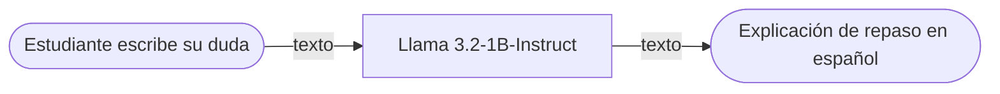

# 🎓 Tutor de repaso con IA para universitarios

*Asistente conversacional que ayuda a estudiantes universitarios a repasar temas académicos mediante inteligencia artificial.*

**Proyecto integrador · Herramientas de Procesamiento para IA (IN1050)**

**Grupo:** VRAM Squad · **Equipo:** 2

## 👥 Integrantes

| Nombre completo | Matrícula |
|---|---|
| Uriel Gutiérrez Mosqueira | 197020-2 |
| Sebastián Guerrero Ambriz | 197113-2 |
| Angela de la Rosa Sevilla | 197002-6 |
| Alejandro Zapien Castrejón | 197097-1 |

## 1. Caso de uso

Se propone desarrollar un tutor conversacional de repaso para estudiantes universitarios que no tengan acceso inmediato a un profesor o compañero.

El sistema permitirá realizar preguntas en lenguaje natural y recibir explicaciones breves en español, con la posibilidad de solicitar más detalles o ejemplos diferentes.

- **Entrada:** Tema académico o duda que el estudiante desea repasar, escrita en lenguaje natural.
- **Salida:** Explicación breve en español, adecuada al nivel universitario, con posibilidad de continuar la conversación.

## 🔀 Cómo funciona

## 2. Modelo abierto elegido

| Dato | Respuesta |
|---|---|
| Identificador | [meta-llama/Llama-3.2-1B-Instruct](https://huggingface.co/meta-llama/Llama-3.2-1B-Instruct) |
| Tarea (pipeline tag) | `text-generation` |
| Número de parámetros | 1.23 mil millones (1.23B) |
| Licencia | Llama 3.2 Community License |
| Limitación o sesgo declarado | Las evaluaciones se realizaron principalmente en inglés y no cubren todos los escenarios. El modelo puede generar respuestas inexactas, sesgadas o inapropiadas. |

## 3. Viabilidad de hardware

**Memoria mínima = N × 2 bytes ≈ 2.46 GB**

### Cálculo de memoria

1.23 × 10⁹ parámetros × 2 bytes (FP16) = 2.46 × 10⁹ bytes ≈ **2.46 GB**

Considerando activaciones, KV cache y otros recursos del framework, se estima un consumo real de entre **4 y 6 GB de VRAM** durante una sesión de chat.

- **VRAM disponible en Colab:** 14.56 GB (GPU NVIDIA Tesla T4).
- **Dónde se ejecuta:** Google Colab con GPU.
- **Por qué:** El modelo cabe cómodamente en la memoria de la Tesla T4, lo que permite ejecutarlo localmente en Colab sin utilizar una API externa. Esto evita costos por petición y facilita realizar pruebas y ajustes al tutor conversacional.

## 4. Riesgo ético

- **Riesgo:** El modelo podría generar explicaciones incorrectas o resolver ejercicios de manera equivocada, provocando que los estudiantes aprendan información falsa.
- **Mitigación:** Mostrar una advertencia indicando que las respuestas pueden contener errores y deben verificarse con el material del curso. El tutor se limitará al repaso general y no resolverá exámenes ni tareas calificadas.

## 5. Evidencia

**Model Card del modelo seleccionado:**

[Ver Model Card de Llama 3.2-1B-Instruct en Hugging Face](https://huggingface.co/meta-llama/Llama-3.2-1B-Instruct)

### Captura de pantalla

